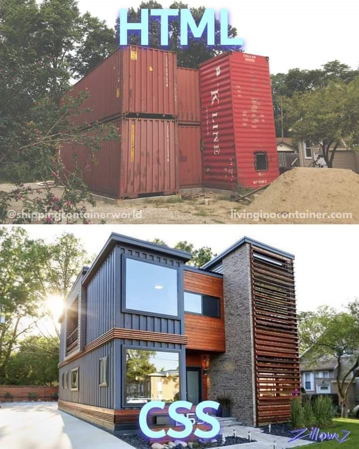
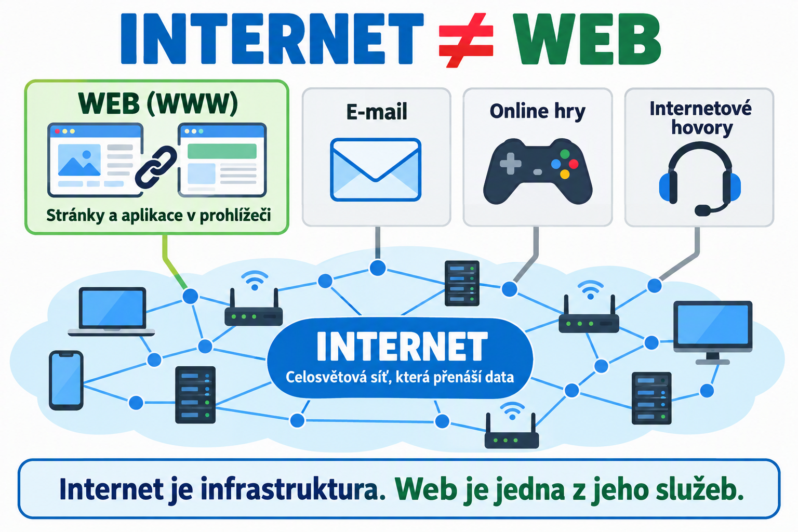
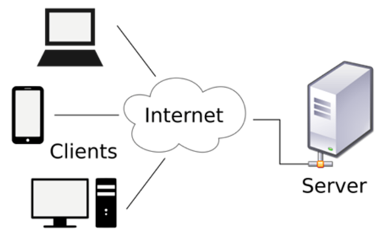
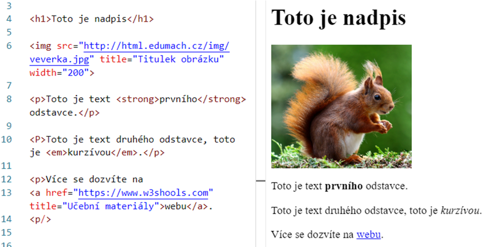

# Web změnil svět

V roce 1989 navrhl britský programátor **Tim Berners-Lee** systém, který umožňoval propojit dokumenty pomocí odkazů. 

- Jeho cílem bylo usnadnit sdílení informací mezi vědci v CERNu.
- O dva roky později vznikl první veřejný web.
- Dnes web používají miliardy lidí každý den.

> V březnu 1989 předložil třiatřicetiletý softwarový inženýr *Tim Berners-Lee* vedení CERNu dokument s nezáživným názvem "Správa informací: Návrh". Jeho nadřízený *Mike Sendall* na něj připsal poznámku, která se stala legendární: "Vágní, ale vzrušující". A hlavně mu dovolil, aby se do toho pustil.
> 
> Problém, který Tim řešil, byl velmi konkrétní a velmi "nudný". CERN byl obří organizace s obrovskou fluktuací vědců. Ti přijížděli na několik měsíců, přivezli si vlastní počítače s vlastními operačními systémy, vytvořili dokumentaci k experimentu a zase odjeli. Znalosti se rozpadaly do nekompatibilních ostrůvků. 
> 
> Berners-Lee chtěl systém, ve kterém by dokumenty ležely kdekoli, na libovolném stroji, a přesto na sebe mohly odkazovat.


## Jedna důležitá myšlenka

Původní HTML **nebylo vytvořeno pro grafický design**. Jeho úkolem bylo popsat:

- co je nadpis,
- co je odstavec,
- co je odkaz,
- co je seznam.

HTML říká: **Co obsah znamená.**
Neříká: **Jak má obsah vypadat.**
Tento princip platí dodnes.


# HTML a CSS

## HTML

Popisuje obsah stránky:

- nadpisy,
- text,
- obrázky,
- odkazy,
- tabulky.

## CSS

Určuje vzhled stránky:

- barvy,
- písmo,
- velikosti,
- rozložení prvků.



> HTML = obsah  
> CSS = vzhled


# Internet ≠ Web

Tyto pojmy velmi často zaměňujeme. Ve skutečnosti ale neznamenají totéž.

## Co je internet?

Internet je celosvětová síť propojených počítačů. Jeho úkolem je přenášet data mezi zařízeními. Po internetu dnes přenášíme:

- webové stránky,
- e-maily,
- videa,
- soubory,
- online hry,
- videohovory.

## Co je web?

Web je jedna ze služeb využívajících internet. Web tvoří stránky propojené odkazy. Každá stránka:

- má svou adresu (URL),
- je uložena na serveru,
- zobrazuje se v prohlížeči.



## Jak funguje web?

Když otevřeš stránku, proběhne přibližně toto:

```text
Prohlížeč
     │
     │ požadavek
     ▼
Server
     │
     │ HTML dokument
     ▼
Prohlížeč
```

Server pošle stránku. Prohlížeč ji zobrazí. Takto funguje celý web.




## Co je webová stránka?

Webová stránka je dokument napsaný v jazyce HTML.

Může obsahovat:

- text,
- obrázky,
- odkazy,
- videa,
- formuláře,
- tabulky.

Jednotlivé stránky mohou být propojeny do většího celku, kterému říkáme **webová prezentace** nebo krátce **web**.


## Co je HTML?

HTML je značkovací jazyk používaný pro tvorbu webových stránek.

Příklad:

```html
<h1>Panská Open Air 2027</h1>

<p>Vítejte na stránkách festivalu.</p>

<a href="program.html">Program</a>
```

HTML používá značky (tagy), které popisují význam obsahu.




## Co je "projekt"?

Projekt není jeden soubor. Projekt je složka obsahující všechny soubory webu.

```text
panska-open-air/
│
├── index.html
├── program.html
├── vstupenky.html
│
├── css/
│   └── style.css
│
└── images/
    └── stage.jpg
```


**Proč je pojem projekt důležitý?**

Všechny soubory spolu souvisejí.

Například:

```html
<a href="program.html">Program</a>
```

říká:

> Otevři soubor `program.html`.

A:

```html

```

říká:

> Otevři obrázek `stage.jpg` ve složce `images`.

Pokud soubor přesuneme jinam, odkaz přestane fungovat.

**Pravidla pojmenování**

Názvy souborů a složek by měly být:

- malými písmeny
- bez diakritiky
- bez mezer
- s použitím `-` nebo `_`

✅ Správně: `moje-prvni-stranka.html`
❌ Špatně: `Moje první stránka.html`

---

# Krátký kvíz

## 1. Co je internet?

1. Program pro prohlížení webu  
2. Celosvětová síť propojených počítačů  
3. Webová stránka

## 2. Co je web?

1. Jedna ze služeb využívajících internet  
2. Operační systém  
3. Programovací jazyk

## 3. K čemu slouží HTML?

1. Ke změně barev a vzhledu stránky  
2. K popisu obsahu stránky  
3. K ukládání obrázků

## 4. K čemu slouží CSS?

1. K popisu struktury dokumentu  
2. K propojení počítačů v internetu  
3. K určení vzhledu stránky

## 5. Co je webová stránka?

1. Dokument napsaný v HTML  
2. Složka s obrázky  
3. Webový server

## 6. Co je projekt?

1. Jeden HTML soubor  
2. Webový prohlížeč  
3. Složka obsahující všechny soubory webu

## 7. Který název souboru je správně?

1. `Moje první stránka.html`
2. `moje-prvni-stranka.html`
3. `MOJE_STRANKA.HTML`

## 8. Co dělá tento odkaz?

```html
<a href="program.html">Program</a>
```

1. Vloží obrázek
2. Otevře soubor `program.html`
3. Změní barvu stránky


## 9. Jaký je rozdíl mezi HTML a CSS?

1. HTML vytváří obsah, CSS vzhled
2. HTML vytváří vzhled, CSS ukládá soubory
3. Žádný rozdíl neexistuje


## 10. Které tvrzení je správně?

1. Web a internet jsou synonyma.
2. Internet je součást webu.
3. Web je jedna ze služeb využívajících internet.

---

# Co nás čeká

Během kurzu se naučíš:

- HTML
- CSS
- obrázky a odkazy
- práci s webovým serverem
- responzivní web
- základy přístupnosti

Na závěr vytvoříš vlastní vícestránkovou webovou prezentaci.


# Shrnutí

Zapamatuj si:

- Internet je síť pro přenos dat.
- Web je služba využívající internet.
- HTML popisuje obsah.
- CSS určuje vzhled.
- Projekt je složka obsahující všechny soubory webu.

