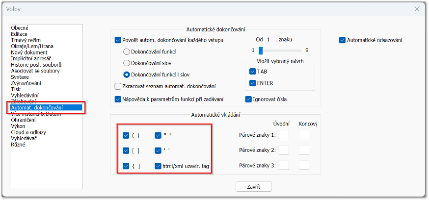
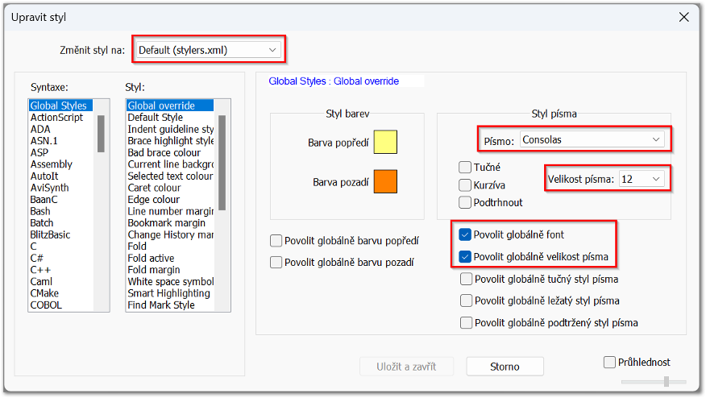
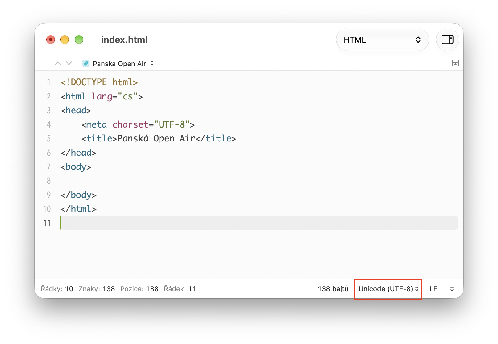

# Úvod do tvorby webu

## Na úvod

> Web není grafika. Web je strukturovaný obsah.

- ⚠️ HTML není Word
- ⚠️ Enterem neodřádkuješ.
- ⚠️ Vícenásobné mezery se ignoruji.
- ⚠️ Vše na stránce musí být v nějaké značce (toto se později „vrátí“ u CSS).
- ⚠️ Prohlížeč negeneruje error. Parsovací algoritmus HTML přesně popisuje, co má prohlížeč udělat s nekorektním vstupem. Díky tomu dnes všechny prohlížeče z rozbité stránky poskládají identický DOM.


## Cvičný projekt

Budeme spolu vytvářet web (projekt): "**Panská Open Air 2027**"

Bude to fiktivní studentský festival zaměřený na hudbu, technologie a kreativitu. Díky jednomu tématu si postupně vyzkoušíš všechny důležité části moderního statického webu.

---

Najdi a prohlédni si web nějakého festivalu a zamysli se:

- z jakých částí se skládá?
- kolik má stránek?
- jak funguje navigace?
- kde se používají obrázky?
- kde jsou seznamy a tabulky?
- zobraz si zdrojový kód stránky
  - Windows: <kbd>Ctrl</kbd> + <kbd>U</kbd>
  - macOS: <kbd>command ⌘</kbd> + <kbd>option ⌥</kbd> + <kbd>U</kbd>

---

# V čem HTML kód psát

HTML kód je obyčejný **prostý text**, který lze psát v libovolném řádkovém textovém editoru. Ve Windows **Poznámkový blok**, v macOS **TextEdit**.

Existují i jiné. Pro naše potřeby bude stačit **Notepad++** (v macOS **CotEditor** z AppStoru). Oba jsou bezplatné.

⚠️ Záměrně nebudeme používat pokročilejší editory. **Nebudeme se učit pouze web psát. Naučíš se webu rozumět.**

## Notepad++

Notepad++ ([https://notepad-plus-plus.org/](https://notepad-plus-plus.org/)) je svobodný textový editor pro Windows. Jedna z hlavních předností je podpora panelů, díky níž se jednodušeji upravuje více souborů najednou. Samozřejmostí je podpora zvýrazňování syntaxe, změna kódování, doplňování kódu, vizuální svorky pro bloky, zobrazení seznamu funkcí a mnoho dalšího. Výhodou je jeho lehkost, svižnost a jednoduché ovládání.

💡 Pokud jste na školním počítači, pak na 99 % je na něm Notepad++ nainstalovaný.

Základní nastavení:

- **Česká lokalizace** (pokud není): Settings → General → Localization → Český
- **Doplňování párových závorek**:
  
- **Písmo a vzhled**: Menu Nastavení → Upravit styl:
  

## Kódování znaků

Vždy si pohlídejte aby bylo **UTF-8**. Obvykle je zobrazeno dole ve stavovém řádku: 



---

# První HTML dokument

## Co se naučíš

- vytvořit projekt
- vytvořit HTML soubor
- používat nadpisy
- používat odstavce
- chápat základní strukturu HTML dokumentu

## Cvičný projekt

### Krok 1

Vytvoř složku:

```text
panska-open-air
```

### Krok 2

Ve složce vytvoř soubor:

```text
index.html
```

### Krok 3

Vytvoř základní HTML dokument (kostru).

```html
<!DOCTYPE html>
<html lang="cs">
<head>
    <meta charset="UTF-8">
    <title>Panská Open Air | Hlavní strana</title>
</head>
<body>
    
</body>
</html>
```

### Krok 4

Vlož obsah:

```html
<h1>Panská Open Air 2027</h1>

<h2>O festivalu</h2>

<p>
Panská Open Air je jednodenní festival zaměřený
na hudbu, technologie a studentskou kreativitu.
</p>
```

### Krok 5

Soubor `index.html` ulož a otevři ve webovém prohlížeči. 

### Krok 6 (opakuje se)

Editor s otevřeným souborem ani stránku v prohlížeči **nezavírej**. Vždy po úpravě nebo doplnění HTML kódu soubor ulož a aktualizuj stránku pro zobrazení výsledku (**Ctrl+R**).


## Rozšiřující úkol

Přidej další odstavec o tom:

- kde se festival koná,
- kolik návštěvníků očekáváš,
- proč by měl někdo festival navštívit.


## Na konci umím

-  ✅ vytvořit projektovou složku
-  ✅ vytvořit soubor `index.html`
-  ✅ vložit nadpis
-  ✅ vložit odstavec
-  ✅ otevřít HTML stránku v prohlížeči
-  ✅ k čemu slouží text v titulku
-  ✅ rozumět základnímu workflow při tvorbě obsahu
